# AnimeRec — recomendador Two-Tower com TensorFlow

Projeto de estudos do **Módulo 3** da pós-graduação: um sistema de recomendação de animes de ponta a ponta, do CSV cru até uma busca vetorial no Postgres, com uma aplicação web para rodar cada etapa e uma página interativa que explica os conceitos.

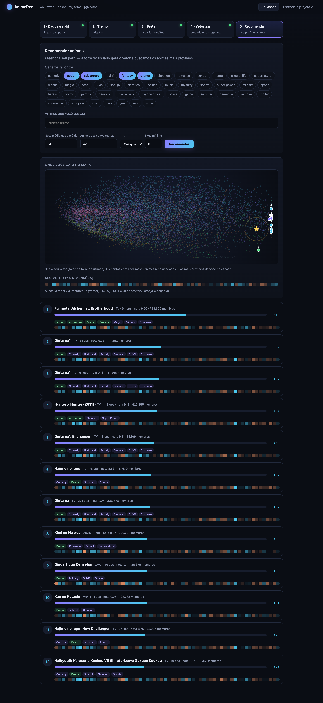

**O que tem aqui**

- Modelo **Two-Tower** (torre do usuário + torre do anime) em TensorFlow/Keras, com o pré-processamento **dentro do grafo**.
- Split **por usuário antes de qualquer cálculo** (sem *data leakage*) e `.adapt()` só com o treino.
- Embeddings de 64 dimensões gravados no **Postgres com pgvector** e índice **HNSW** (cosseno). Sem Postgres, a API cai sozinha para numpy.
- API **FastAPI** + front em uma página só, com gráficos e animações feitos em canvas/SVG puro (sem build, sem framework).
- Página `/learn`: um tour animado e interativo pelos conceitos.

Dataset: Kaggle [*Anime Recommendations Database*](https://www.kaggle.com/datasets/CooperUnion/anime-recommendations-database) (`anime.csv` + `rating.csv`). O dataset **não** está no repositório (veja [Como rodar](#como-rodar)).

---

## Como rodar

Coloque o `archive.zip` baixado do Kaggle em `data/archive.zip`.

### Local (uv)

```bash
uv sync
uv run uvicorn animerec.api:app --reload   # http://localhost:8000
```

Sem Postgres, a busca usa numpy. Para usar o pgvector:

```bash
docker compose up -d db
```

### Tudo em Docker (API + front + Postgres/pgvector)

```bash
docker compose up --build   # http://localhost:8000
```

Depois, no front, siga as abas **1 Dados e split → 2 Treino → 3 Teste → 4 Vetorizar → 5 Recomendar**. Os modelos ficam em `./artifacts` e os vetores no volume `pgdata`.

---

## Telas da aplicação (`/`)

### 1 · Dados e split
Descompacta o zip, limpa, descarta notas `-1` e separa treino/teste **por usuário**. Mostra o funil de dados, o split 80/20 e, dentro de cada usuário, a divisão 50/50 entre histórico (monta o perfil) e alvo (vira exemplo de treino).

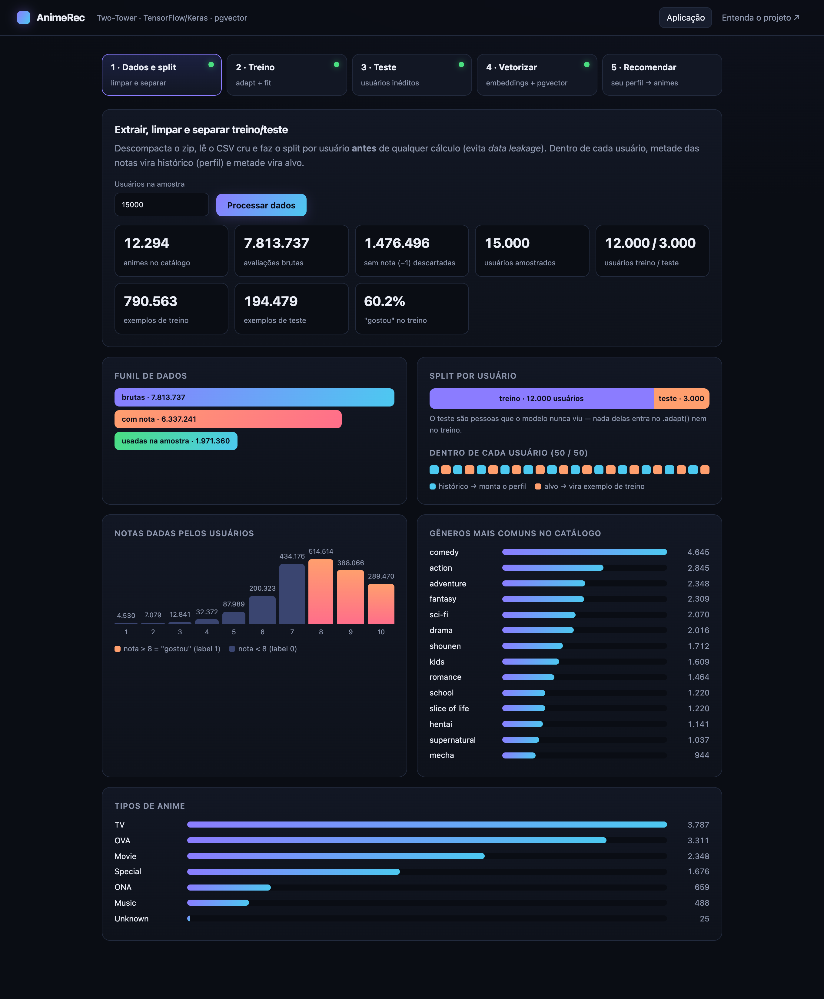

### 2 · Treino
`.adapt()` só no treino e `fit` das duas torres, com curvas de loss/AUC ao vivo, tabela por época e log do pipeline.

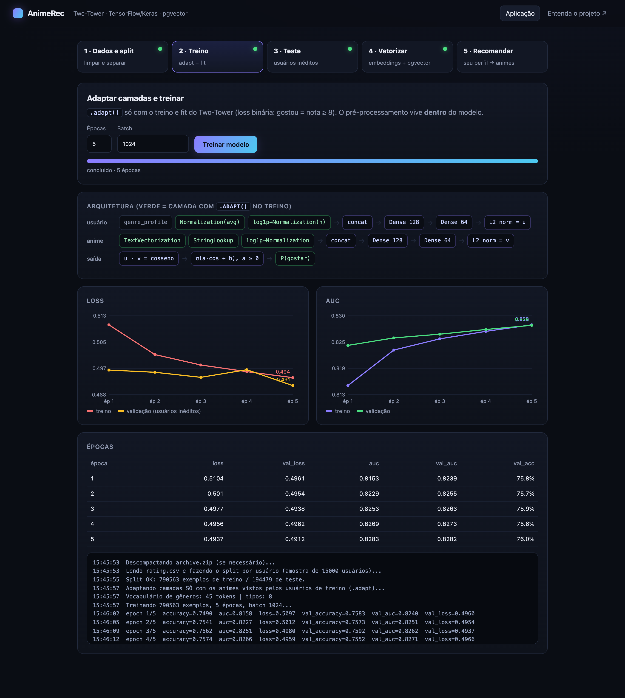

### 3 · Teste
AUC, accuracy e loss em usuários que o modelo nunca viu, e **Recall@20** contra a baseline "mais populares".

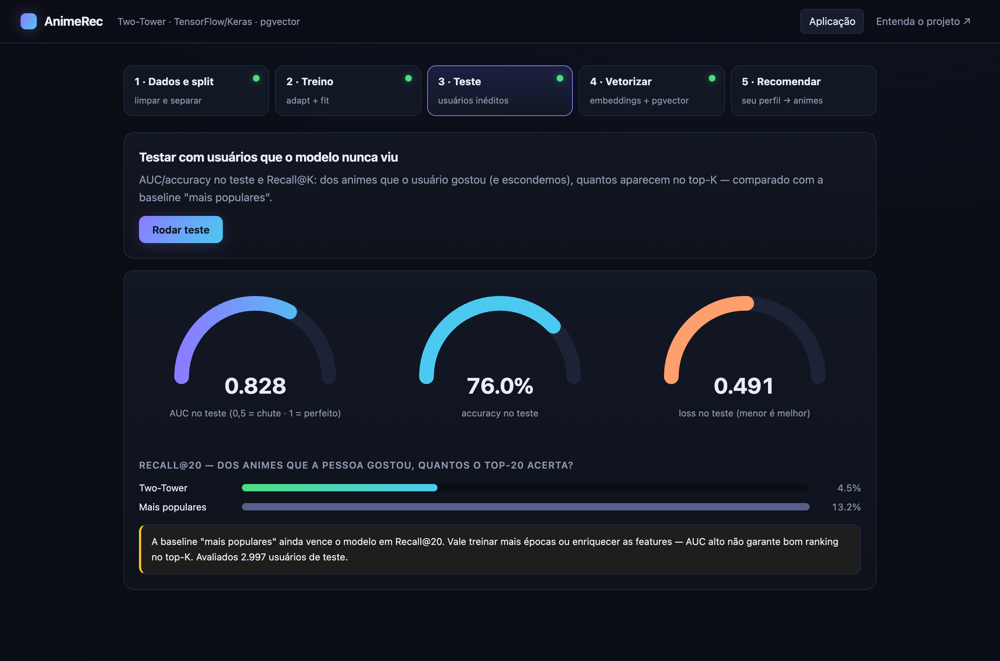

### 4 · Vetorizar
A torre de itens gera um vetor por anime, gravado no Postgres/pgvector com índice HNSW. O mapa mostra os 12.294 animes projetados em 2D (PCA); passe o mouse para ver os nomes.

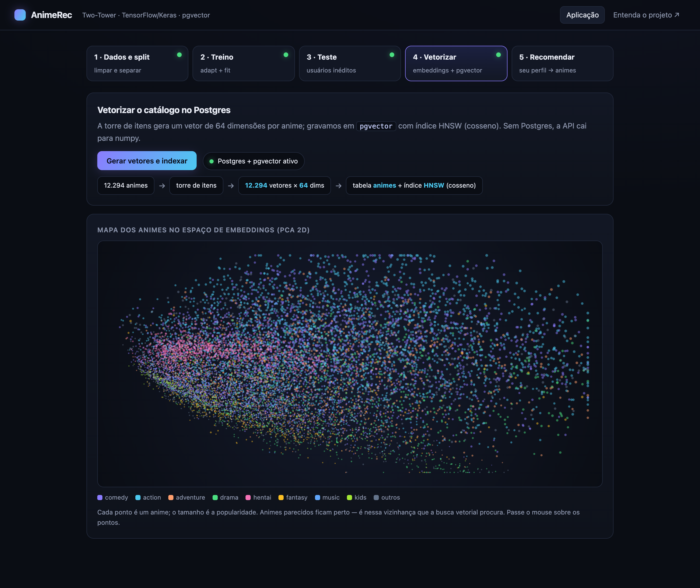

### 5 · Recomendar
O usuário informa gêneros e animes que gostou; a torre do usuário gera o vetor e a busca vetorial traz os vizinhos mais próximos. A tela mostra onde o usuário caiu no mapa (★), o vetor de 64 dimensões e o score de cada recomendação (veja a imagem no topo).

---

## Entenda o projeto (`/learn`)

Uma página animada em que dá para mexer em cada conceito:

| | |
|---|---|
| **A ideia**: usuários e animes vivem num círculo (vetores normalizados); escolha gêneros e veja os vizinhos. | **Cosseno → probabilidade**: arraste o vetor e mexa em `a` e `b` de `σ(a·cos + b)`. |
| 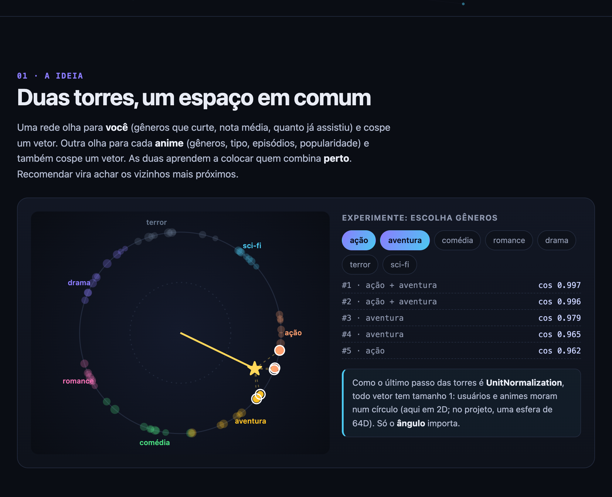 | 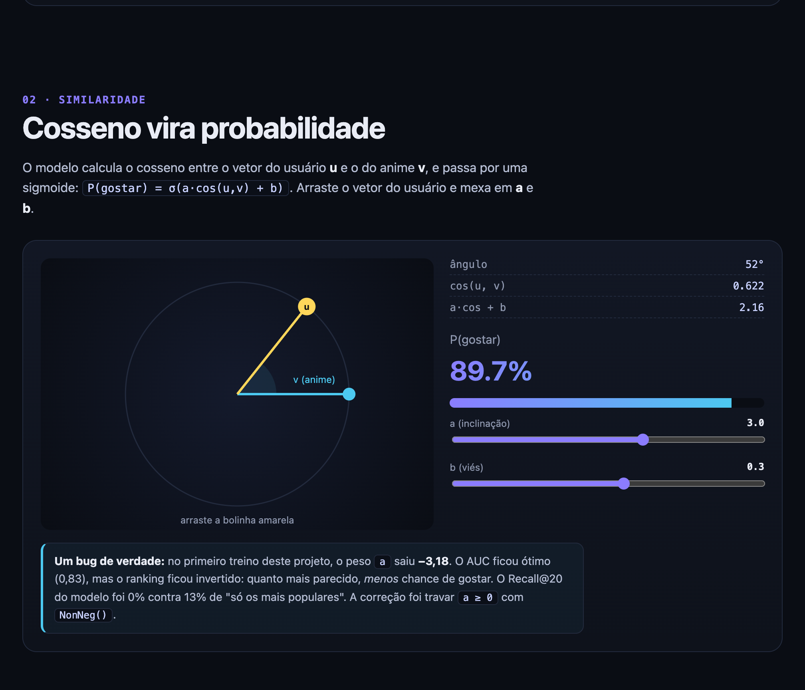 |
| **Split sem vazamento**: divida os usuários e veja o teste contaminar o μ. | **Pré-processamento no grafo**: multi-hot, one-hot, `log1p` e z-score. |
| 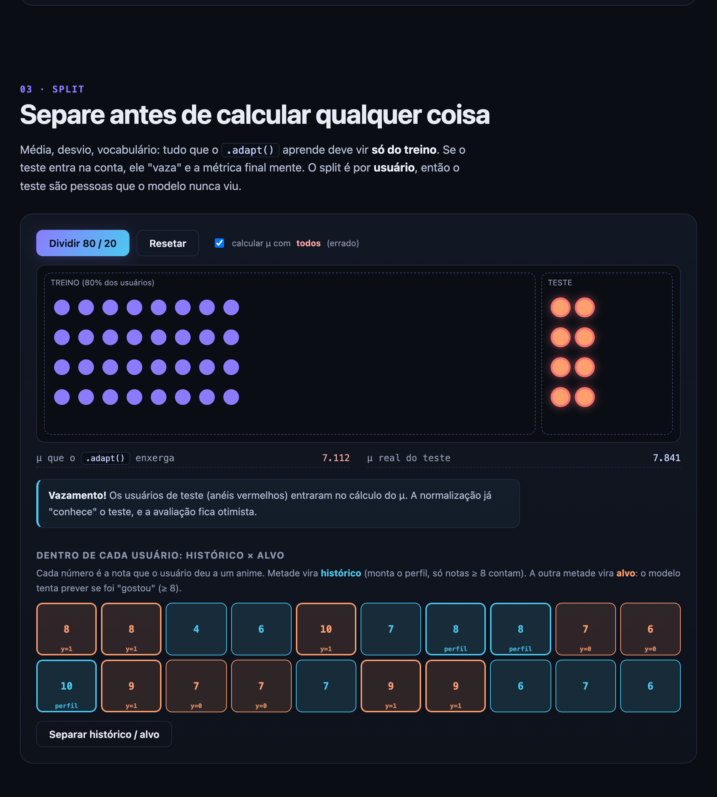 | 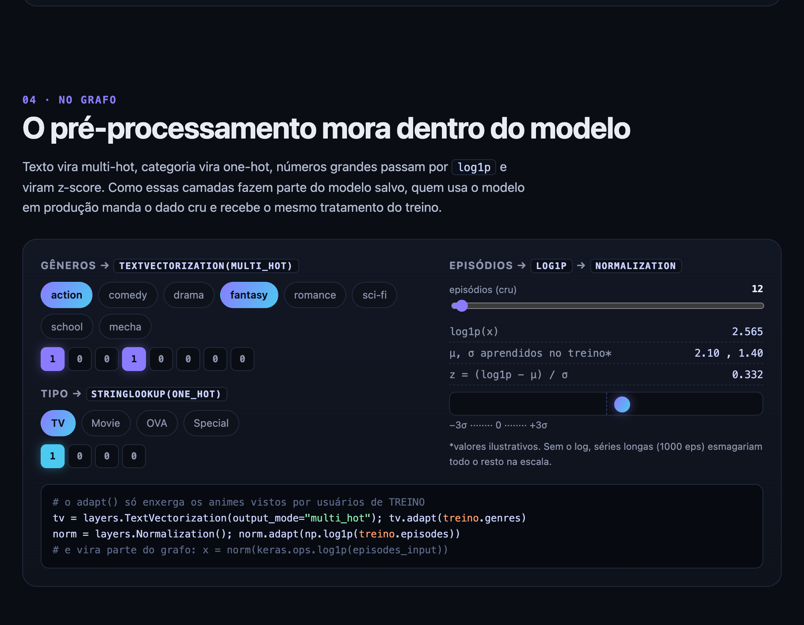 |
| **AUC e Recall@K** interativos. | **Busca HNSW**: camadas de atalhos vs. força bruta. |
| 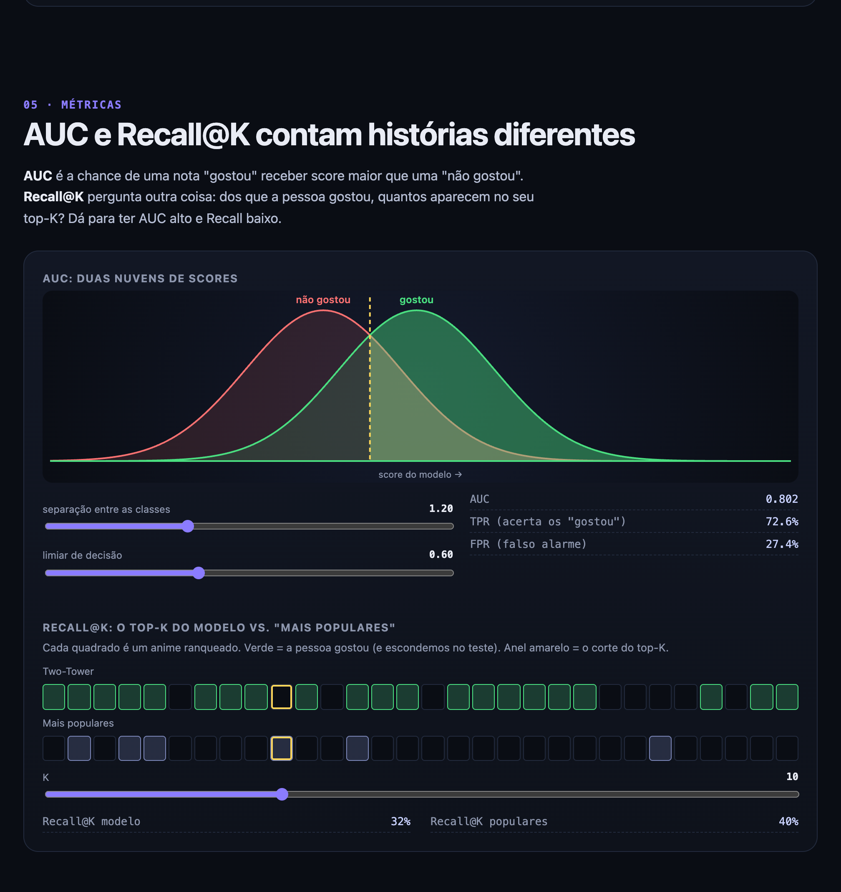 | 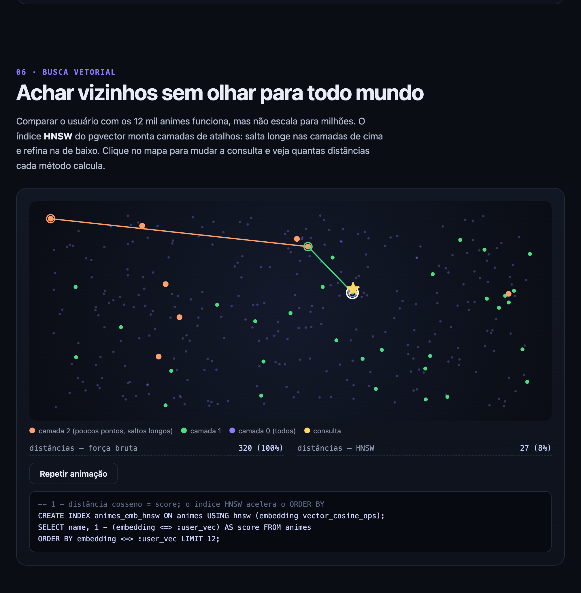 |

---

## Como funciona

### Pipeline

| Etapa | O que acontece | Código |
|---|---|---|
| 1. Dados | unzip, limpeza, descarta `rating = -1`, **split por usuário (80/20) antes de qualquer cálculo**; em cada usuário 50% das notas = histórico (perfil), 50% = alvo | `data.py` |
| 2. Adapt + treino | `TextVectorization` (multi-hot de gêneros), `StringLookup` one-hot (tipo), `log1p` + `Normalization` (episódios, membros), `Normalization` (nota), todos com `.adapt()` só no treino. `tf.data` com `prefetch(AUTOTUNE)` | `modeling.py`, `pipeline.py` |
| 3. Teste | AUC/accuracy em usuários nunca vistos + Recall@K vs. baseline "mais populares" | `pipeline.py` |
| 4. Vetorizar | torre de itens → embedding 64d por anime → tabela `animes` com `vector(64)` + índice HNSW (cosseno) | `store.py` |
| 5. Recomendar | formulário → torre do usuário → vetor → `ORDER BY embedding <=> vetor` no Postgres | `serve.py`, `api.py` |

### Modelo

- **Torre do usuário:** perfil de gêneros curtidos (média do multi-hot dos animes com nota ≥ 8 no histórico), nota média e volume assistido → `Dense 128` → `Dense 64` → `UnitNormalization`.
- **Torre do anime:** gêneros, tipo, episódios, popularidade e nota → `Dense 128` → `Dense 64` → `UnitNormalization`.
- **Saída:** `P(gostar) = σ(a·cos(u, v) + b)`, com label = nota ≥ 8 e `a ≥ 0` (`NonNeg`).
- **Cold start:** usuário novo informa gêneros/animes que curtiu e o perfil é montado igual ao do treino.

---

## Resultados

Amostra de 15.000 usuários (12.000 treino / 3.000 teste), 5 épocas, batch 1024.

| Dados | |
|---|---|
| Animes no catálogo | 12.294 |
| Avaliações brutas | 7.813.737 (1.476.496 sem nota descartadas) |
| Exemplos de treino / teste | 790.563 / 194.479 |
| Proporção "gostou" (treino) | 60,2% |

| Métrica (teste, usuários inéditos) | Valor |
|---|---|
| AUC | **0,828** |
| Accuracy | **76,0%** |
| Loss | 0,492 |
| Recall@20 — Two-Tower | **4,7%** |
| Recall@20 — mais populares (baseline) | **13,2%** |

> **Leitura honesta:** o AUC é bom, mas no ranking do top-20 o modelo **ainda perde para recomendar só os mais populares**. As features atuais (gêneros, tipo, episódios, popularidade, nota) dão pouca informação para personalizar além disso.

### Um bug que valeu a lição

No primeiro treino, o peso `a` da sigmoide saiu **−3,18**. O AUC ficou ótimo (0,83), mas o ranking ficou invertido: quanto mais parecido, *menor* a chance de gostar. As recomendações eram animes obscuros e o Recall@20 do modelo foi **0%**. A correção foi travar `a ≥ 0` com `kernel_constraint=NonNeg()` (e inicializar em 3). Depois disso o Recall foi a 4,7% e as recomendações passaram a fazer sentido. A moral: **AUC alto não garante bom top-K; compare sempre com uma baseline**.

### Próximos passos

- Enriquecer as features (ids de anime com embedding aprendido, estúdio, ano, sinopse).
- Treinar com *negative sampling* e loss de ranking (por exemplo, softmax *in-batch*), mais próxima do objetivo do top-K.
- Filtrar/ponderar o viés de popularidade na avaliação.

---

## Estrutura

```
src/animerec/
  config.py     caminhos e hiperparâmetros
  data.py       extração, limpeza e split por usuário
  modeling.py   camadas adaptadas e as duas torres
  pipeline.py   orquestra prepare → train → evaluate → index
  store.py      pgvector: ingestão e busca
  serve.py      inferência e fallback numpy
  viz.py        dados das visualizações (PCA 2D, distribuição do catálogo)
  api.py        FastAPI
  static/       index.html (app), learn.html (tour), theme.css
docs/img/       screenshots usados neste README
Dockerfile · docker-compose.yml · pyproject.toml (uv)
data/ e artifacts/ ficam fora do git
```

## Stack

Python 3.12 · TensorFlow/Keras · FastAPI · Postgres + pgvector · pandas/numpy/scipy · uv · Docker
